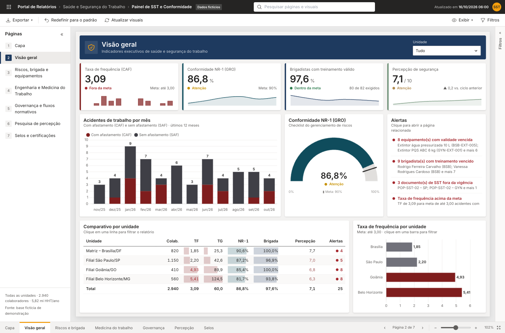
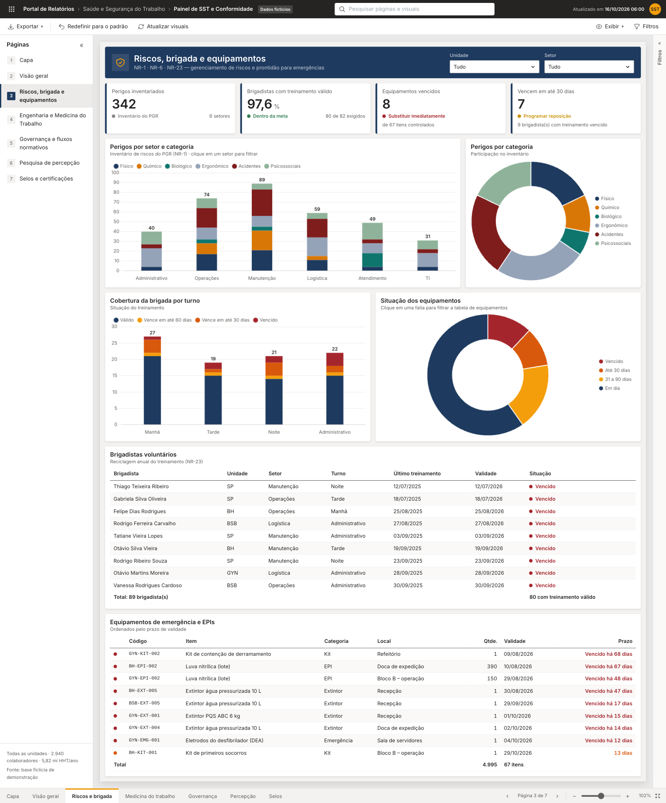
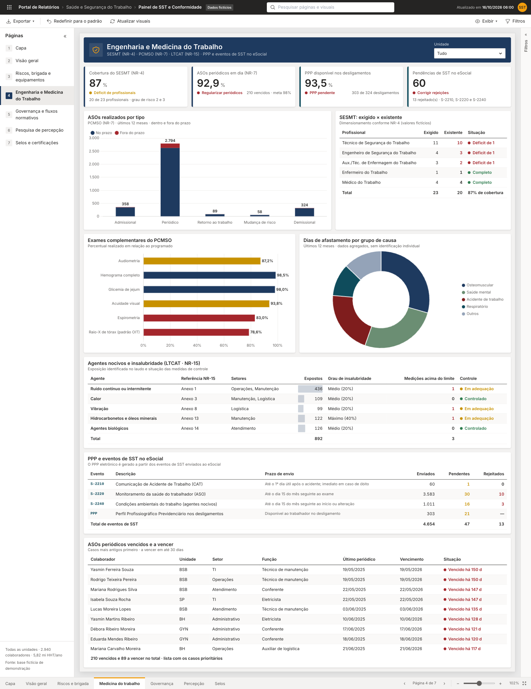
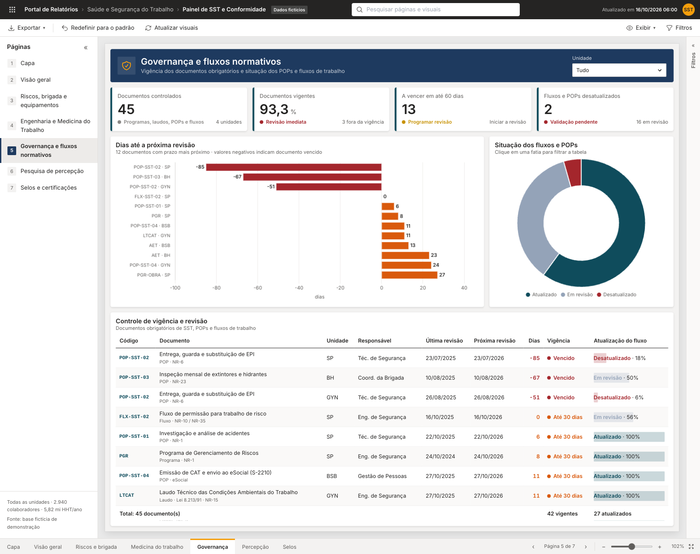
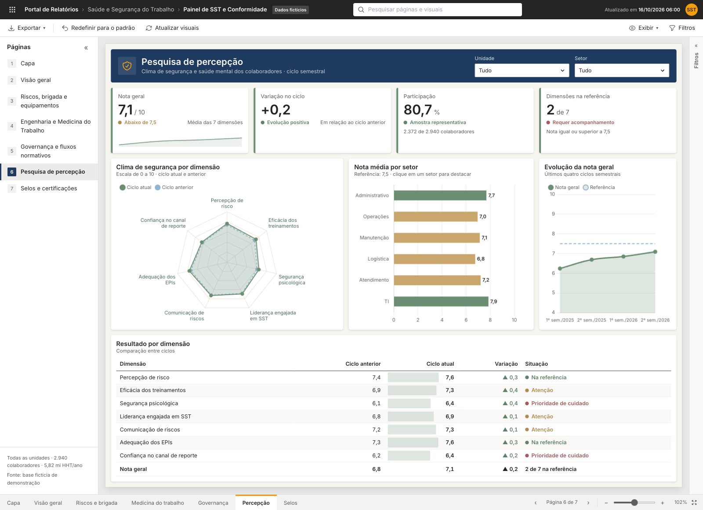
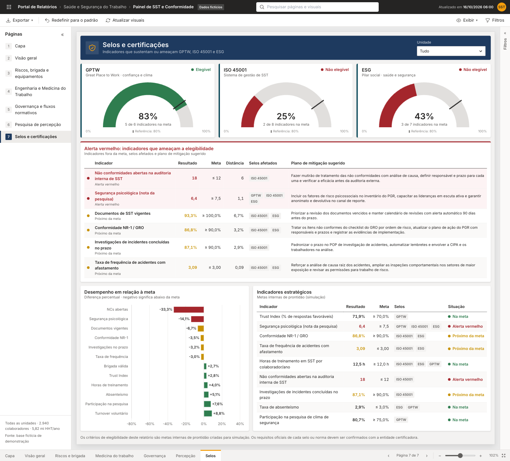

<p align="center">
  <a href="https://larissahorrara.github.io/painel-sst-conformidade/"></a>
</p>

<h1 align="center">Painel de SST e Conformidade</h1>

<p align="center">
  
  
  
  
  
  
  
  
  
</p>

<p align="center">
  <a href="https://larissahorrara.github.io/painel-sst-conformidade/"></a>
  <a href="https://colab.research.google.com/github/larissahorrara/painel-sst-conformidade/blob/main/python/painel_sst_colab.ipynb"></a>
</p>

<p align="center">
  <a href="https://larissahorrara.github.io/painel-sst-conformidade/"><strong>Abrir o painel</strong></a> ·
  <a href="#16-versão-2-painel-em-python-google-colab">Versão Python</a> ·
  <a href="data/">Base de dados</a> ·
  <a href="#5-insights-da-análise">Insights</a> ·
  <a href="#7-medidas-para-o-power-bi-dax">Medidas DAX</a> ·
  <a href="CHANGELOG.md">Versões</a>
</p>

Relatório gerencial interativo de **Saúde e Segurança do Trabalho (SST)**: gestão de riscos, prontidão para emergências, engenharia e medicina do trabalho, governança normativa e impacto da cultura de segurança em selos e certificações (GPTW, ISO 45001 e ESG).

O projeto tem duas versões do painel e uma base de dados:

- **Versão 1 – `index.html`**: o relatório, em um único arquivo HTML, com a linguagem visual de um relatório Power BI.
- **Versão 2 – `python/`**: o painel reconstruído em Python, em um notebook do Google Colab que gera os dados, calcula os indicadores, monta os gráficos com Plotly e exporta um painel em HTML que funciona sem internet.
- **`data/`**: a base de dados por trás do relatório da versão 1, em modelo estrela, pronta para importar no Power BI ou usar no Excel.

As seções 1 a 15 descrevem a versão 1. A versão 2 está documentada na [seção 16](#16-versão-2-painel-em-python-google-colab).

> **Todos os nomes, unidades e números são fictícios** e foram gerados para demonstração, nas duas versões. Nenhum dado se refere a pessoas ou empresas reais. Os insights da seção 5 mostram o tipo de leitura que o painel permite; não descrevem uma organização real.

---

## Sumário

1. [Objetivo e público](#1-objetivo-e-público)
2. [Estrutura do repositório](#2-estrutura-do-repositório)
3. [Como abrir e usar o relatório](#3-como-abrir-e-usar-o-relatório)
4. [Páginas do relatório](#4-páginas-do-relatório)
5. [Insights da análise](#5-insights-da-análise)
6. [Base de dados](#6-base-de-dados)
7. [Medidas para o Power BI (DAX)](#7-medidas-para-o-power-bi-dax)
8. [Regras de negócio](#8-regras-de-negócio)
9. [Arquitetura técnica do HTML](#9-arquitetura-técnica-do-html)
10. [Como os dados fictícios foram gerados](#10-como-os-dados-fictícios-foram-gerados)
11. [Como usar com dados reais](#11-como-usar-com-dados-reais)
12. [Referências normativas](#12-referências-normativas)
13. [Glossário](#13-glossário)
14. [Limitações e cuidados](#14-limitações-e-cuidados)
15. [Histórico de versões](#15-histórico-de-versões)
16. [Versão 2: painel em Python (Google Colab)](#16-versão-2-painel-em-python-google-colab)

---

## 1. Objetivo e público

O painel reúne em um só lugar os indicadores que costumam ficar espalhados entre engenharia de segurança, medicina do trabalho, RH e compliance. Ele responde a perguntas como:

- Onde e com que frequência acontecem os acidentes, e quais unidades puxam os resultados para baixo?
- Os equipamentos de emergência, a brigada e os documentos legais estão em dia?
- O SESMT está dimensionado? Os ASOs e os eventos de SST no eSocial estão regulares?
- Como os colaboradores percebem a segurança e a saúde mental no trabalho?
- Quais indicadores ameaçam a conquista ou a renovação de selos como GPTW, ISO 45001 e índices ESG?

| Público | Uso principal |
|---|---|
| Diretoria e RH | Visão geral, selos e certificações, plano de ação |
| Engenharia de Segurança do Trabalho | Riscos, brigada, equipamentos, governança documental |
| Medicina do Trabalho | ASOs, exames, afastamentos, eventos de SST no eSocial |
| Compliance e auditoria | Vigência de documentos, não conformidades, metas por selo |

## 2. Estrutura do repositório

```text
painel-sst-conformidade/
├── index.html                      # versão 1: o painel (abre direto no navegador e no GitHub Pages)
├── python/
│   ├── painel_sst_colab.ipynb      # versão 2: notebook do Google Colab
│   ├── painel_sst.html             # painel gerado pelo notebook (funciona sem internet)
│   └── base_sst.xlsx               # tabelas geradas pelo notebook
├── data/
│   ├── base-dados-sst.xlsx         # base em modelo estrela, com conferência e dicionário
│   ├── csv/                        # as mesmas 20 tabelas e o dicionário, uma por arquivo CSV
│   └── dados.json                  # extração bruta da camada de dados do painel
├── docs/
│   ├── img/                        # telas das duas versões e imagem de pré-visualização social
│   └── configuracao-github.md      # passo a passo para publicar e marcar como template
├── scripts/
│   ├── extrair_dados.js            # index.html → data/dados.json
│   ├── montar_base.py              # data/dados.json → data/base-dados-sst.xlsx
│   └── exportar_csv.py             # data/base-dados-sst.xlsx → data/csv/
├── .github/
│   ├── ISSUE_TEMPLATE/             # formulários de erro e de sugestão de melhoria
│   └── pull_request_template.md
├── CHANGELOG.md
├── CONTRIBUTING.md
├── package.json                    # dependência do script de extração (TypeScript)
└── requirements.txt                # dependência dos scripts Python (openpyxl)
```

### Telas

Clique em qualquer tela para abrir a página correspondente no painel interativo.

| Capa | Visão geral |
|---|---|
| [](https://larissahorrara.github.io/painel-sst-conformidade/#capa) | [](https://larissahorrara.github.io/painel-sst-conformidade/#visao) |
| **Riscos, brigada e equipamentos** | **Engenharia e Medicina do Trabalho** |
| [](https://larissahorrara.github.io/painel-sst-conformidade/#riscos) | [](https://larissahorrara.github.io/painel-sst-conformidade/#medicina) |
| **Governança e fluxos normativos** | **Pesquisa de percepção** |
| [](https://larissahorrara.github.io/painel-sst-conformidade/#governanca) | [](https://larissahorrara.github.io/painel-sst-conformidade/#percepcao) |
| **Selos e certificações** | |
| [](https://larissahorrara.github.io/painel-sst-conformidade/#certificacoes) | |

As telas da versão em Python estão na [seção 16](#16-versão-2-painel-em-python-google-colab).

## 3. Como abrir e usar o relatório

1. Acesse o link **Abrir o painel**, no topo desta página, ou baixe o repositório e dê dois cliques em `index.html`. Ele abre em qualquer navegador atual (Chrome, Edge, Firefox ou Safari).
2. É preciso **conexão com a internet na abertura**, porque três bibliotecas são carregadas de CDNs públicos:
   - Tailwind CSS (Play CDN): estilos.
   - Chart.js 4.4.1: gráficos.
   - TypeScript 5.4.5: compila o código do relatório no próprio navegador.
3. A primeira carga leva alguns segundos, por causa da compilação do TypeScript. Depois disso, toda a navegação é local.

Para abrir e usar a versão em Python, veja a [seção 16](#16-versão-2-painel-em-python-google-colab).

### Recursos da interface

| Recurso | Onde fica | O que faz |
|---|---|---|
| Painel de páginas | Lateral esquerda (recolhível) | Navega entre as 7 páginas |
| Abas de página e setas | Rodapé | Mesma navegação, com "Página X de 7" |
| Zoom | Rodapé, à direita | −, +, controle deslizante e "Ajustar à largura" |
| Segmentações | Cabeçalho de cada página | Lista suspensa de **Unidade** (todas as páginas) e **Setor** (Riscos e Percepção) |
| Painel de filtros | Lateral direita (recolhível) | Filtros da página e de todas as páginas, com pesquisa e borracha para limpar |
| Pesquisa | Barra superior | Leva à página ou ao visual pesquisado e o destaca |
| Exportar | Barra de ações | PDF da página (impressão) ou dados da página em CSV |
| Redefinir para o padrão | Barra de ações | Volta todos os filtros ao estado inicial |
| Atualizar visuais | Barra de ações | Redesenha os gráficos |
| Exibir | Barra de ações | Zoom e exibição dos painéis laterais |
| Funil, foco e "…" | Canto de cada visual (ao passar o mouse) | Filtros que afetam o visual, modo de foco em tela cheia e exportação em CSV |
| Filtragem cruzada | Gráficos e tabelas | Clicar em uma barra, fatia ou linha filtra o restante da página |

Em telas com pelo menos 1280 px de largura, a página tem tamanho fixo e escala como no Power BI. Em telas menores (tablet e celular), o relatório vira layout responsivo.

## 4. Páginas do relatório

| Nº | Página | Tema de cor | Principais visuais |
|---|---|---|---|
| 1 | **Capa** | Azul-marinho e amarelo | Título, quatro números de destaque, índice e foto |
| 2 | **Visão geral** | Misto (cada cartão na cor da sua temática) | KPIs com minigráficos, acidentes por mês, medidor de conformidade NR-1, alertas, comparativo e TF por unidade |
| 3 | **Riscos, brigada e equipamentos** | Segurança do Trabalho | Perigos por setor e categoria (PGR), brigada por turno, situação dos equipamentos, tabelas de brigadistas e de equipamentos |
| 4 | **Engenharia e Medicina do Trabalho** | Segurança do Trabalho | SESMT exigido × existente, ASOs por tipo, exames complementares, afastamentos, agentes nocivos (LTCAT · NR-15), eventos de SST no eSocial e PPP, periódicos vencidos |
| 5 | **Governança e fluxos normativos** | Normativo | Dias até a próxima revisão, situação dos fluxos e POPs, controle de vigência (PGR, PGR da obra, PCMSO, LTCAT, AET, PAE, POPs e fluxos) |
| 6 | **Pesquisa de percepção** | Saúde mental | Radar por dimensão, nota por setor, evolução por ciclo, tabela por dimensão |
| 7 | **Selos e certificações** | Normativo, com alerta em bordô | Medidores de elegibilidade (GPTW, ISO 45001, ESG), tabela de alerta vermelho com plano de mitigação, desempenho em relação à meta |

### Paleta temática

| Temática | Cores | Uso |
|---|---|---|
| Segurança do Trabalho | Azul-marinho `#1E3A5F` com amarelo `#F59E0B` | Riscos, brigada, equipamentos, medicina do trabalho |
| Acidentes de Trabalho | Bordô `#7F1D1D` e preto | Taxas de frequência e gravidade, acidentes por mês |
| Saúde Mental | Sálvia `#6B8E73`, azul-pastel `#93B4D1` e off-white | Pesquisa de percepção (sem vermelho puro) |
| Parte normativa | Azul-petróleo `#0F4C5C` e grafite | Governança, conformidade, selos |

As cores de situação (verde, amarelo, laranja e vermelho) seguem a mesma regra em todas as páginas.

---

## 5. Insights da análise

Leitura dos dados na data de referência de **16/10/2026**, considerando as quatro unidades. Todos os números vêm da base (`data/base-dados-sst.xlsx`) e podem ser reproduzidos no painel.

### 5.1 Resumo executivo

1. **Os resultados se concentram em duas unidades.** Goiânia e Belo Horizonte reúnem 33% do efetivo, mas respondem por 56% dos acidentes com afastamento e 60% dos dias perdidos. São também as únicas sem elegibilidade a nenhum dos três selos.
2. **A organização está elegível só ao GPTW.** No consolidado, o GPTW tem 5 de 6 indicadores na meta. A ISO 45001 tem 2 de 8 e o ESG, 3 de 7. Os dois indicadores em alerta vermelho são segurança psicológica (6,44 para meta de 7,5) e não conformidades abertas (18 para limite de 12).
3. **Saúde mental aparece em três frentes ao mesmo tempo:**
   - 17,8% dos perigos inventariados são psicossociais;
   - 26% dos dias de afastamento são por saúde mental;
   - as duas notas mais baixas da pesquisa são confiança no canal de reporte (6,38) e segurança psicológica (6,44).
4. **A brigada parece em dia, mas não está.** O índice é de 97,6%, porém 11 treinamentos vencem em até 30 dias. Sem reciclagem, o índice cai para 84,1%, abaixo do limite de atenção de 85%.
5. **Há um ganho rápido em São Paulo.** Atualizar um POP vencido e levar a conformidade NR-1 de 87,2% para 90% torna a filial elegível ao ESG. Somando o fechamento de não conformidades e o prazo das investigações, ela fica elegível também à ISO 45001.

### 5.2 Acidentes de trabalho

| Unidade | Taxa de frequência (CAF) | Taxa de gravidade | Dias sem acidente com afastamento |
|---|---|---|---|
| Matriz – Brasília | 1,85 | 25,3 | 128 |
| Filial São Paulo | 2,20 | 42,6 | 47 |
| Filial Goiânia | **4,93** | **89,9** | 22 |
| Filial Belo Horizonte | **5,41** | **124,5** | 9 |
| **Consolidado** | **3,09** (meta: até 3,00) | 60,0 | — |

- **TF consolidada logo acima da meta.** A taxa de frequência fica em 3,09, quase no limite de 3,00, mas a média esconde a dispersão: Goiânia e Belo Horizonte têm o dobro ou mais da taxa de Brasília.
- **Gravidade concentrada em Belo Horizonte.** A taxa de gravidade da filial é quase cinco vezes a de Brasília, e ela está há apenas 9 dias sem acidente com afastamento.
- **Possível subnotificação de ocorrências leves.** Foram registrados 43 acidentes sem afastamento para 18 com afastamento, cerca de 2,4 para 1. Os modelos de pirâmide de acidentes esperam muito mais ocorrências leves e quase-acidentes para cada afastamento. Essa leitura combina com a baixa confiança no canal de reporte (6,38).

### 5.3 Riscos e prontidão para emergências

- **Inventário de riscos.** São 342 perigos no PGR. Ergonômicos (24,9%) e de acidentes (22,8%) lideram; os psicossociais (17,8%) aparecem empatados com os físicos.
- **Concentração por setor.** Manutenção (89) e Operações (74) somam 47,7% dos perigos.
- **Equipamentos vencidos.** São 8, dos quais 5 em Goiânia, o equivalente a 31% de todo o inventário da unidade. Há 4 extintores vencidos: 2 em Goiânia, 1 em Brasília e 1 em Belo Horizonte. Outros 7 itens vencem em até 30 dias.
- **Brigada por turno.**
  - O turno administrativo concentra 4 dos 9 brigadistas com treinamento vencido.
  - No turno da noite, 6 de 21 brigadistas (29%) estão vencidos ou vencem em até 30 dias, o que fragiliza um período em que costuma haver menos pessoas na unidade para responder a uma emergência.

### 5.4 Engenharia e medicina do trabalho

- **ASOs periódicos.** São 210 vencidos, e 92,9% estão em dia, contra meta de 98%. Belo Horizonte (89,8%) e Goiânia (90,5%) têm os piores resultados. Os periódicos respondem por 86% de todos os ASOs feitos fora do prazo (169 de 196), então o problema está no agendamento dos periódicos, não nos admissionais ou demissionais.
- **SESMT.** O dimensionamento está em 20 de 23 profissionais (87%):
  - em Belo Horizonte faltam um técnico de segurança e um auxiliar ou técnico de enfermagem do trabalho;
  - em Goiânia falta o engenheiro de segurança.
  
  As duas unidades com déficit são as de maior taxa de frequência. É uma associação, não prova de causa, mas reforça a prioridade.
- **Exames complementares.** Raio-X de tórax (78% a 79%) e espirometria (79% a 85%) são os exames com menor realização em **todas** as unidades. Isso aponta para um problema comum, como rede credenciada ou agenda, e não local.
- **Afastamentos.** Causas osteomusculares (29,4%) e de saúde mental (26,0%) somam 55,4% dos dias de afastamento, contra 21% dos acidentes de trabalho. O peso dos afastamentos osteomusculares acompanha a liderança dos riscos ergonômicos no inventário.
- **Agentes nocivos (LTCAT).** O ruído responde por 49% dos trabalhadores expostos (436 de 892). Há 3 medições acima do limite de tolerância: 2 em Belo Horizonte e 1 em Goiânia.
- **eSocial e PPP.**
  - Há 13 eventos de SST rejeitados e 47 pendentes.
  - 21 desligamentos (6,5%) estão sem PPP disponível.
  
  Como o PPP eletrônico depende dos eventos de SST, corrigir as rejeições do S-2240 e do S-2220 também resolve parte das pendências de PPP.

### 5.5 Governança documental

- **Documentos vencidos.** Os 3 documentos fora da vigência são POPs:
  - POP-SST-02 (EPI) em São Paulo e em Goiânia;
  - POP-SST-03 (inspeção de extintores) em Belo Horizonte.
- **Falha de processo ligada.** Belo Horizonte tem o POP de inspeção de extintores vencido e também um extintor vencido.
- **Programas legais.** PGR, PCMSO e LTCAT estão vigentes, mas o PGR de São Paulo vence em 8 dias e o LTCAT de Goiânia em 11. Ao todo, 12 documentos estão vencidos ou vencem em até 30 dias.
- **Fluxos e POPs.** Dos 45 documentos, 27 têm o fluxo atualizado, 16 estão em revisão e 2 estão desatualizados.

### 5.6 Percepção dos colaboradores

- **Nota geral.** Está em 7,09, abaixo da referência de 7,5, mas sobe há quatro ciclos seguidos: 6,24 → 6,69 → 6,85 → 7,09.
- **Dimensões.**
  - Todas as sete dimensões melhoraram.
  - Segurança psicológica teve o maior ganho (+0,37), mas continua entre as duas menores notas.
  - Liderança engajada em SST (+0,13) e comunicação de riscos (+0,11) foram as que menos evoluíram.
- **Setores.** Logística (6,75) e Operações (6,95) têm as notas mais baixas e estão entre os três setores com mais perigos inventariados. Quem está mais exposto é quem se sente menos seguro.
- **Participação.** Chegou a 80,7%, acima da meta de 75%, o que dá confiança à leitura.

### 5.7 Selos e certificações

| Escopo | GPTW | ISO 45001 | ESG |
|---|---|---|---|
| Matriz – Brasília | Elegível (83%) | Elegível (88%) | Elegível (86%) |
| Filial São Paulo | Elegível (83%) | Não elegível (38%) | Não elegível (57%) |
| Filial Goiânia | Não elegível (33%) | Não elegível (25%) | Não elegível (14%) |
| Filial Belo Horizonte | Não elegível (0%) | Não elegível (0%) | Não elegível (0%) |
| **Consolidado** | **Elegível (83%)** | **Não elegível (25%)** | **Não elegível (43%)** |

- **Goiânia no GPTW.** A filial é barrada pelo Trust Index (66,2%, abaixo do mínimo de referência de 70%), que bloqueia a elegibilidade qualquer que seja o resto.
- **Belo Horizonte.** Tem 7 indicadores em alerta vermelho: segurança psicológica, conformidade NR-1, taxa de frequência, horas de treinamento, não conformidades, investigações no prazo e documentos vigentes.
- **Cenário simulado para São Paulo.**
  - Atualizar o POP-SST-02 e elevar a conformidade NR-1 a 90% leva o ESG a 6 de 7 indicadores (86%, elegível) e a ISO 45001 a 62% ("em risco").
  - Somando o fechamento de duas não conformidades (de 5 para 3) e investigações no prazo acima de 90%, a ISO 45001 chega a 7 de 8 (88%, elegível).

### 5.8 Plano de ação priorizado

| Prioridade | Ação | Onde | Indicadores que melhora | Prazo sugerido |
|---|---|---|---|---|
| 1 | Substituir os 8 equipamentos vencidos, começando pelos 4 extintores | Goiânia, Brasília e Belo Horizonte | Equipamentos vencidos, conformidade NR-23 | Imediato |
| 2 | Reciclar os 9 treinamentos de brigada vencidos e os 11 que vencem em 30 dias, com prioridade para o turno da noite | Todas | Índice de brigadistas ativos | 30 dias |
| 3 | Atualizar o POP-SST-02 e o POP-SST-03 e antecipar a revisão do PGR de São Paulo e do LTCAT de Goiânia | São Paulo, Goiânia e Belo Horizonte | Documentos vigentes, ISO 45001, ESG | 30 dias |
| 4 | Corrigir os 13 eventos rejeitados no eSocial e regularizar os 21 PPPs pendentes | Todas, com foco em Belo Horizonte | Pendências eSocial, PPP disponível | 30 dias |
| 5 | Mutirão de ASOs periódicos e revisão da rede credenciada para raio-X e espirometria | Belo Horizonte e Goiânia primeiro | Periódicos em dia, exames complementares | 60 dias |
| 6 | Recompor o SESMT: técnico de segurança e enfermagem em Belo Horizonte, engenheiro de segurança em Goiânia | Belo Horizonte e Goiânia | Cobertura do SESMT | 60 dias |
| 7 | Análise de causa raiz dos acidentes e inspeções comportamentais em Manutenção e Operações | Belo Horizonte e Goiânia | Taxa de frequência, taxa de gravidade | 30 a 90 dias |
| 8 | Programa de segurança psicológica: riscos psicossociais no PGR, capacitação de lideranças e canal de reporte anônimo com devolutiva | Todas | Segurança psicológica, canal de reporte, afastamentos por saúde mental, ISO 45001, ESG, GPTW | 90 dias |
| 9 | Campanha de registro de quase-acidentes e ocorrências leves | Todas | Qualidade da notificação, confiança no canal de reporte | 90 dias |
| 10 | Fechar as não conformidades da auditoria interna, com dono e prazo para cada uma | São Paulo e Belo Horizonte primeiro | Não conformidades abertas, ISO 45001 | 90 dias |

---

## 6. Base de dados

`data/base-dados-sst.xlsx` reproduz exatamente os dados exibidos no relatório na data de referência de **16/10/2026**. Cada aba contém uma Tabela do Excel com o mesmo nome, o que facilita a importação no Power BI ("Obter dados › Excel", marcando as tabelas).

### Convenções

- **Prefixo `d`**: dimensão (cadastro). **Prefixo `f`**: fato (medições).
- **Chave entre tabelas**: `id_unidade` (sigla da unidade: BSB, SP, GYN, BH).
- **Percentuais em fração**: 0,9 = 90%.
- **Colunas do tipo "Fórmula"** (dias até o vencimento, situação, déficit, percentual realizado) são calculadas pelo Excel a partir da **data de referência** da aba `LEIA-ME` (célula B4, editável). Para acompanhar o dia corrente, troque o valor por `=HOJE()`.
- **Valores em azul** foram digitados; **fundo amarelo** indica parâmetro.

### Tabelas

| Tabela | Granularidade (uma linha por…) | Linhas |
|---|---|---|
| `dUnidade` | unidade | 4 |
| `dSetor` | setor | 6 |
| `dCalendario` | mês dos últimos 12 meses | 12 |
| `fAcidentesMensal` | unidade × mês | 48 |
| `fRiscos` | unidade × setor × categoria de risco | 144 |
| `fBrigadistas` | brigadista | 89 |
| `fEquipamentos` | equipamento ou lote de EPI | 67 |
| `fDocumentos` | documento × unidade | 45 |
| `fPesquisaDimensao` | unidade × dimensão da pesquisa | 28 |
| `fPesquisaSetor` | unidade × setor | 24 |
| `fPesquisaCiclo` | unidade × ciclo semestral | 16 |
| `fIndicadoresGestao` | unidade (janela de 12 meses) | 4 |
| `fSesmt` | unidade × profissional do SESMT | 20 |
| `fAsos` | unidade × tipo de ASO | 20 |
| `fPeriodicosPendentes` | colaborador com periódico vencido ou a vencer (amostra) | 48 |
| `fExames` | unidade × exame complementar | 24 |
| `fAfastamentos` | unidade × grupo de causa | 20 |
| `fAgentesNocivos` | unidade × agente nocivo | 20 |
| `fEventosEsocial` | unidade × evento de SST | 12 |
| `dMetas` | indicador estratégico | 12 |

Além das tabelas, a planilha tem:

- **`Conferencia`**: recalcula 11 KPIs do consolidado a partir das tabelas e os compara com os valores exibidos no painel. O resultado atual é "Base confere com o painel".
- **`Dicionario`**: as 132 colunas, com tipo, descrição e relacionamento.

### Modelo de relacionamentos

```mermaid
erDiagram
    dUnidade ||--o{ fAcidentesMensal : id_unidade
    dUnidade ||--o{ fRiscos : id_unidade
    dUnidade ||--o{ fBrigadistas : id_unidade
    dUnidade ||--o{ fEquipamentos : id_unidade
    dUnidade ||--o{ fDocumentos : id_unidade
    dUnidade ||--o{ fPesquisaDimensao : id_unidade
    dUnidade ||--o{ fPesquisaSetor : id_unidade
    dUnidade ||--o{ fPesquisaCiclo : id_unidade
    dUnidade ||--|| fIndicadoresGestao : id_unidade
    dUnidade ||--o{ fSesmt : id_unidade
    dUnidade ||--o{ fAsos : id_unidade
    dUnidade ||--o{ fPeriodicosPendentes : id_unidade
    dUnidade ||--o{ fExames : id_unidade
    dUnidade ||--o{ fAfastamentos : id_unidade
    dUnidade ||--o{ fAgentesNocivos : id_unidade
    dUnidade ||--o{ fEventosEsocial : id_unidade
    dSetor ||--o{ fRiscos : setor
    dSetor ||--o{ fBrigadistas : setor
    dSetor ||--o{ fPesquisaSetor : setor
    dSetor ||--o{ fPeriodicosPendentes : setor
    dCalendario ||--o{ fAcidentesMensal : mes
```



No Power BI, crie as relações como **um para muitos**, com filtro em direção única (da dimensão para o fato). `dMetas` fica sem relação: é consultada pelas medidas.

## 7. Medidas para o Power BI (DAX)

Medidas equivalentes às do relatório. Os nomes de tabela e coluna são os da base.

```dax
-- Acidentes
Horas-homem = SUM ( dUnidade[horas_homem_ano] )
Acidentes CAF = SUM ( fAcidentesMensal[acidentes_caf] )
Acidentes SAF = SUM ( fAcidentesMensal[acidentes_saf] )
Taxa de frequência = DIVIDE ( [Acidentes CAF], [Horas-homem] ) * 1000000
Taxa de gravidade =
    DIVIDE ( SUM ( fIndicadoresGestao[dias_perdidos_12m] ), [Horas-homem] ) * 1000000

-- Conformidade (média ponderada pelo efetivo)
Conformidade NR-1 =
DIVIDE (
    SUMX ( fIndicadoresGestao, fIndicadoresGestao[conformidade_nr1] * RELATED ( dUnidade[colaboradores] ) ),
    SUMX ( fIndicadoresGestao, RELATED ( dUnidade[colaboradores] ) )
)

-- Brigada, equipamentos e documentos
Brigadistas válidos =
    CALCULATE ( COUNTROWS ( fBrigadistas ), fBrigadistas[situacao] <> "Vencido" )
Índice de brigadistas ativos =
    MIN ( 1, DIVIDE ( [Brigadistas válidos], SUM ( fIndicadoresGestao[brigadistas_exigidos] ) ) )
Equipamentos vencidos =
    CALCULATE ( COUNTROWS ( fEquipamentos ), fEquipamentos[situacao] = "Vencido" )
Documentos vencidos =
    CALCULATE ( COUNTROWS ( fDocumentos ), fDocumentos[vigencia] = "Vencido" )
Documentos vigentes % = 1 - DIVIDE ( [Documentos vencidos], COUNTROWS ( fDocumentos ) )

-- Pesquisa de percepção (ponderada pelos respondentes de cada unidade)
Nota de percepção =
VAR Peso =
    ADDCOLUMNS (
        fPesquisaDimensao,
        "@resp", LOOKUPVALUE (
            fIndicadoresGestao[respondentes_pesquisa],
            fIndicadoresGestao[id_unidade], fPesquisaDimensao[id_unidade]
        )
    )
RETURN
    DIVIDE ( SUMX ( Peso, fPesquisaDimensao[nota_ciclo_atual] * [@resp] ), SUMX ( Peso, [@resp] ) )
Participação na pesquisa =
    DIVIDE ( SUM ( fIndicadoresGestao[respondentes_pesquisa] ), SUM ( dUnidade[colaboradores] ) )

-- Engenharia e medicina do trabalho
Cobertura do SESMT =
    DIVIDE ( SUM ( fSesmt[exigido] ) - SUM ( fSesmt[deficit] ), SUM ( fSesmt[exigido] ) )
ASOs periódicos em dia =
    1 - DIVIDE ( SUM ( fIndicadoresGestao[periodicos_vencidos] ), SUM ( fIndicadoresGestao[periodicos_total] ) )
PPP disponível nos desligamentos =
    DIVIDE ( SUM ( fIndicadoresGestao[ppp_emitidos] ), SUM ( fIndicadoresGestao[desligamentos_12m] ) )
Pendências eSocial = SUM ( fEventosEsocial[pendentes] ) + SUM ( fEventosEsocial[rejeitados] )
```

**Situação calculada no Power BI.** As colunas de situação da planilha refletem a data em que o Excel foi recalculado. Para que o Power BI calcule a situação no dia da atualização, recrie-as como colunas calculadas. Exemplo para brigadistas:

```dax
Dias para vencimento = INT ( fBrigadistas[data_validade] - TODAY () )
Situação =
SWITCH (
    TRUE (),
    fBrigadistas[Dias para vencimento] < 0, "Vencido",
    fBrigadistas[Dias para vencimento] <= 30, "Vence em até 30 dias",
    fBrigadistas[Dias para vencimento] <= 60, "Vence em até 60 dias",
    "Válido"
)
```

As medidas acima seguem a mesma lógica verificada na aba `Conferencia` da planilha, mas não foram testadas dentro do Power BI.

## 8. Regras de negócio

### Prazos e situações

| Objeto | Vencido | Crítico | Atenção | Em dia |
|---|---|---|---|---|
| Treinamento de brigada | < 0 dia | até 30 dias | 31 a 60 dias | acima de 60 dias |
| Equipamentos e EPIs | < 0 dia | até 30 dias | 31 a 90 dias | acima de 90 dias |
| Documentos e fluxos | < 0 dia | até 30 dias | 31 a 60 dias | acima de 60 dias |
| ASO periódico | < 0 dia | até 30 dias | — | — |

### Faixas dos KPIs

| Indicador | Dentro da meta | Atenção | Fora da meta |
|---|---|---|---|
| Taxa de frequência (CAF) | até 2,00 | 2,01 a 3,00 | acima de 3,00 |
| Conformidade NR-1 | 90% ou mais | 80% a 89,9% | abaixo de 80% |
| Brigadistas válidos | 95% ou mais | 85% a 94,9% | abaixo de 85% |
| Percepção de segurança | 7,5 ou mais | 6,5 a 7,4 | abaixo de 6,5 |
| ASOs periódicos em dia | 98% ou mais | 93% a 97,9% | abaixo de 93% |

### Selos e certificações

- **Metas.** Cada indicador estratégico tem meta, sentido (mínimo ou máximo) e selos afetados, registrados na aba `dMetas`.
- **Situação de um indicador.** "Na meta"; "Próximo da meta" quando fica até 8% distante da meta; "Alerta vermelho" quando a distância passa de 8%. A comparação usa o valor arredondado exibido na tela.
- **Elegibilidade por selo.** É o percentual de indicadores do selo que estão na meta. 80% ou mais é "Elegível"; de 60% a 79% é "Em risco"; abaixo de 60% é "Não elegível".
- **Indicador bloqueante.** O Trust Index abaixo de 70% torna o GPTW "Não elegível", qualquer que seja o percentual.
- **Não conformidades abertas.** A meta é 3 por unidade. No consolidado, ela é multiplicada pelo número de unidades.
- **Natureza dos critérios.** São **metas internas de prontidão para simulação**, não os requisitos oficiais das entidades certificadoras.

### Alertas

Os alertas da Visão geral reúnem as condições críticas de todas as páginas:

- equipamentos, treinamentos de brigada e documentos vencidos;
- taxa de frequência acima da meta;
- conformidade NR-1 abaixo de 80%;
- indicadores de selo em alerta vermelho;
- ASOs periódicos vencidos;
- déficit no SESMT;
- agentes nocivos sem controle eficaz;
- eventos de SST rejeitados no eSocial.

São de atenção os itens a vencer em 30 dias, a conformidade NR-1 entre 80% e 90%, os eventos pendentes no eSocial, os PPPs não emitidos e as dimensões da pesquisa abaixo de 6,5.

### Consolidação "Todas as unidades"

- **Contagens** (acidentes, dias perdidos, brigadistas, documentos, eventos, NCs) são somadas.
- **Percentuais de gestão** são ponderados pelo efetivo.
- **Notas da pesquisa** são ponderadas pelo número de respondentes.
- **Taxas** de frequência e gravidade são recalculadas sobre o total de horas-homem, nunca como média das unidades.

## 9. Arquitetura técnica do HTML

O código fica todo em `index.html`, dentro de `<script type="text/typescript" id="app-ts">`. Um pequeno `<script type="module">` no final do arquivo transpila esse TypeScript no navegador e executa o resultado.

| Seção do código | Responsabilidade |
|---|---|
| 0 a 1 | Declarações e tipos do domínio |
| 2 | Configuração base: unidades, setores, catálogos, modelos de documentos, paleta |
| 3 | Utilitários: gerador pseudoaleatório com semente, datas, formatação |
| 4 | Geração dos dados de cada unidade e consolidação |
| 5 | Regras de negócio: KPIs, métricas, elegibilidade, alertas |
| 5B | Dados e alertas de engenharia e medicina do trabalho |
| 6 | Tema visual e plugins do Chart.js (rótulos de dados e marcador de meta) |
| 7 | Componentes HTML (cartão de KPI, barra de dados, ponto de situação) |
| 8 | Estado do relatório e cadastro das páginas |
| 9 | Renderização de cada página |
| 10 | Segmentações e painel de filtros |
| 11 | Painéis, página fixa e zoom |
| 12 | Orquestração, pesquisa, modo de foco, menus e exportação |
| 13 | Inicialização e eventos |

Só a página visível é desenhada, para evitar gráficos com tamanho zero em seções ocultas. O código passa na verificação estrita do TypeScript (`strict: true`).

## 10. Como os dados fictícios foram gerados

- **Semente fixa.** Cada unidade tem uma semente própria, então os dados são sempre os mesmos ao abrir o relatório.
- **Índice de maturidade em SST.** Cada unidade tem um índice que orienta os números: Brasília 0,86; São Paulo 0,74; Goiânia 0,66; Belo Horizonte 0,55. Quanto menor o índice, mais vencimentos, notas mais baixas e mais alertas. Os insights da seção 5 refletem esse gradiente.
- **Datas relativas.** No painel, as datas são calculadas a partir do dia em que o relatório é aberto, por isso ele sempre mostra vencimentos "recentes". A base em Excel congela esses dados na data de referência de 16/10/2026.
- **Obra em São Paulo.** A filial tem uma obra de ampliação fictícia e por isso é a única com o documento "PGR da obra (NR-18)".
- **SESMT.** O dimensionamento é fictício. Em uso real, deve ser conferido no quadro da NR-4 vigente.

## 11. Como usar com dados reais

**Caminho recomendado: Power BI**

1. Preencha as tabelas de `data/base-dados-sst.xlsx` (ou os CSVs de `data/csv/`) mantendo os nomes das abas e das colunas. Apague as linhas fictícias.
2. No Power BI Desktop, use **Obter dados › Excel** e marque as tabelas `d…`, `f…` e `dMetas`.
3. Crie as relações da seção 6 e as medidas da seção 7.
4. Recrie as colunas de situação como colunas calculadas com `TODAY()`.
5. Monte as páginas seguindo a seção 4 e aplique a paleta temática.

**Regenerar a base a partir do painel**

Se a lógica de geração mudar no `index.html`, os três scripts refazem a base na mesma sequência usada neste repositório:

```bash
npm install                                                     # instala o TypeScript usado na extração
npm run dados                                                   # index.html → data/dados.json
pip install -r requirements.txt                                 # instala o openpyxl
python scripts/montar_base.py data/dados.json data/base-dados-sst.xlsx
# abra e salve a planilha no Excel uma vez, para gravar os valores das fórmulas
python scripts/exportar_csv.py                                  # data/base-dados-sst.xlsx → data/csv/
```

A data de referência passa a ser o dia em que `npm run dados` rodar.

**Caminho alternativo: manter o HTML**

Substitua a geração fictícia (seção 4 do código) por uma leitura de dados reais, por exemplo um JSON exportado da base, mantendo as interfaces `DadosUnidade` e `DadosMedicina`. As seções de regras e de visualização não precisam mudar.

## 12. Referências normativas

| Tema | Referência |
|---|---|
| Gerenciamento de riscos (GRO/PGR) | NR-1 |
| SESMT | NR-4 |
| EPI | NR-6 |
| PCMSO e ASOs | NR-7 |
| Insalubridade e agentes nocivos | NR-15 (anexos 1, 3, 8, 13 e 14) e Lei 8.213/91 (LTCAT) |
| Ergonomia (AET) | NR-17 |
| Construção (PGR da obra, que substituiu o PCMAT) | NR-18, em vigor desde 03/01/2022 |
| Proteção contra incêndios e brigada | NR-23 |
| Eventos de SST | eSocial S-2210 (CAT), S-2220 (monitoramento da saúde), S-2240 (condições ambientais) |
| PPP | Emitido em meio eletrônico, a partir dos eventos de SST no eSocial, desde 01/2023 |

Prazos de envio e requisitos legais devem ser conferidos nas versões oficiais vigentes das normas e do leiaute do eSocial antes de qualquer uso real.

## 13. Glossário

| Sigla | Significado |
|---|---|
| AET | Análise Ergonômica do Trabalho |
| ASO | Atestado de Saúde Ocupacional |
| CAF / SAF | Acidente com afastamento / sem afastamento |
| CAT | Comunicação de Acidente de Trabalho |
| CIPA | Comissão Interna de Prevenção de Acidentes e de Assédio |
| EPI | Equipamento de Proteção Individual |
| ESG | Ambiental, Social e Governança (critérios de sustentabilidade) |
| GPTW | Great Place to Work |
| GRO | Gerenciamento de Riscos Ocupacionais |
| HHT | Horas-homem trabalhadas |
| ISO 45001 | Norma internacional de sistema de gestão de saúde e segurança ocupacional |
| LT | Limite de tolerância |
| LTCAT | Laudo Técnico das Condições Ambientais do Trabalho |
| NC | Não conformidade |
| NR | Norma Regulamentadora |
| PAE | Plano de Atendimento a Emergências |
| PCMAT | Programa de Condições e Meio Ambiente de Trabalho na Indústria da Construção (substituído pelo PGR da obra) |
| PCMSO | Programa de Controle Médico de Saúde Ocupacional |
| PGR | Programa de Gerenciamento de Riscos |
| POP | Procedimento Operacional Padrão |
| PPP | Perfil Profissiográfico Previdenciário |
| SESMT | Serviços Especializados em Segurança e em Medicina do Trabalho |
| TF / TG | Taxa de frequência / taxa de gravidade (por milhão de horas-homem trabalhadas) |

## 14. Limitações e cuidados

- **Dados fictícios.** Não use os números para decisões. Os insights ilustram o método de leitura.
- **Associação não é causa.** Os insights apontam coincidências entre indicadores (por exemplo, déficit no SESMT e taxa de frequência alta), não relações de causa comprovadas.
- **Internet na abertura.** O relatório depende de três CDNs. Para uso offline, as bibliotecas precisam ser embutidas no arquivo.
- **Selos e certificações.** Os critérios de elegibilidade são uma simulação interna.
- **Dados pessoais.** Com dados reais, nomes de colaboradores e informações de saúde exigem cuidado com a LGPD. Os afastamentos devem continuar agregados, sem identificação individual nem CID.
- **Foto da capa.** Se veio de banco de imagens, confirme a licença de uso antes de distribuir o relatório.
- **Versões independentes.** A versão em Python gera um cenário próprio, com outra estrutura e outras metas. Os números das duas versões não são comparáveis entre si.

## 15. Histórico de versões

As mudanças de cada versão estão em [CHANGELOG.md](CHANGELOG.md).

## 16. Versão 2: painel em Python (Google Colab)

A versão 2 reconstrói o painel em Python, dentro de um notebook do Google Colab. O próprio notebook gera os dados fictícios, calcula os indicadores com pandas e NumPy, monta os gráficos com Plotly e exporta o resultado como um painel em HTML com cinco abas. Cada etapa do código vem explicada no notebook, o que facilita estudar, adaptar e reproduzir a análise.

<p>
  <a href="https://colab.research.google.com/github/larissahorrara/painel-sst-conformidade/blob/main/python/painel_sst_colab.ipynb"></a>
</p>

[Abrir o painel gerado pela versão Python](https://larissahorrara.github.io/painel-sst-conformidade/python/painel_sst.html)

### Telas da versão 2

Clique em qualquer tela para abrir o painel gerado pela versão Python.

| Visão geral | Riscos e brigada |
|---|---|
| [](https://larissahorrara.github.io/painel-sst-conformidade/python/painel_sst.html) | [](https://larissahorrara.github.io/painel-sst-conformidade/python/painel_sst.html) |
| **Governança** | **Percepção** |
| [](https://larissahorrara.github.io/painel-sst-conformidade/python/painel_sst.html) | [](https://larissahorrara.github.io/painel-sst-conformidade/python/painel_sst.html) |
| **Selos e certificações** | |
| [](https://larissahorrara.github.io/painel-sst-conformidade/python/painel_sst.html) | |

### 16.1 Como executar

**No Google Colab (recomendado)**

1. Clique no botão **Abrir no Colab**, acima.
2. No menu, escolha **Ambiente de execução › Executar tudo**. O notebook fica salvo sem resultados, por isso os gráficos só aparecem depois da execução.
3. Acompanhe a prévia do painel, com as abas funcionando, no próprio notebook (Etapa 15).
4. Ao final, o Colab baixa o painel (`painel_sst.html`) e a base de dados (`base_sst.xlsx`). Se o navegador perguntar, permita vários downloads.

**No computador**

```bash
pip install pandas numpy plotly openpyxl jupyter
jupyter notebook python/painel_sst_colab.ipynb
```

Fora do Colab, os arquivos gerados ficam na mesma pasta do notebook.

### 16.2 O que o notebook gera

| Arquivo | Conteúdo |
|---|---|
| `painel_sst.html` | Painel completo com cinco abas, em um único arquivo de cerca de 5 MB. Funciona sem internet, porque a biblioteca de gráficos vai embutida. Ao imprimir (Ctrl + P), sai como relatório com todas as abas em sequência. |
| `base_sst.xlsx` | Doze planilhas: `colaboradores`, `horas_trabalhadas`, `acidentes`, `tf_tg_mensal`, `riscos_nr1`, `brigada`, `equipamentos`, `documentos_legais`, `pops_pae`, `pesquisa_respostas`, `pesquisa_resumo` e `selos_certificacoes`. |

### 16.3 Abas do painel

| Nº | Aba | Principais visuais |
|---|---|---|
| 1 | **Visão Geral** | Cards de Taxa de Frequência, Taxa de Gravidade, Conformidade NR-1 e Satisfação em SST, com meta, comparação com o período anterior e minigráfico de tendência; alertas ordenados por gravidade; TF e TG acumuladas em 12 meses; acidentes por mês; TF por setor |
| 2 | **Riscos e Brigada** | Matriz de risco 5×5; maior nível de risco por setor e categoria; riscos altos e críticos sem plano de ação; cobertura da brigada por prédio e turno; validade dos equipamentos de segurança |
| 3 | **Governança** | Linha do tempo de vigência dos documentos legais (PGR, PCMSO, LTCAT, AET, prontuário elétrico e projeto de incêndio); quadro do fluxo de revisão dos POPs e PAE por etapa |
| 4 | **Percepção** | Resumo do ciclo; percepção em escala de concordância por dimensão; participação na pesquisa; evolução do percentual favorável por dimensão; mapa por setor e dimensão |
| 5 | **Selos e Certificações** | Situação de GPTW, ISO 45001 e ESG; Tabela de Alerta Vermelho com plano de mitigação; atingimento da meta por indicador |

No topo de cada aba, uma **Leitura rápida** resume em uma frase o principal achado, gerada automaticamente a partir dos dados.

### 16.4 Etapas do notebook

| Etapa | O que faz |
|---|---|
| 1 | Prepara o ambiente e importa as bibliotecas |
| 2 | Define os parâmetros: data de referência, setores, prédios, turnos, efetivo, metas e semente |
| 3 | Gera a base de colaboradores e o vencimento dos ASOs periódicos |
| 4 | Gera 24 meses de horas trabalhadas e acidentes e calcula TF e TG |
| 5 | Monta o inventário de riscos da NR-1 com a matriz 5×5 |
| 6 | Gera a brigada de incêndio e verifica a cobertura por prédio e turno |
| 7 | Gera o inventário de equipamentos e as faixas de vencimento |
| 8 | Registra a vigência dos documentos legais e o status dos POPs e PAE |
| 9 | Simula quatro ciclos trimestrais da pesquisa de percepção |
| 10 | Cruza os indicadores com os critérios de GPTW, ISO 45001 e ESG |
| 11 | Aplica a identidade visual a todos os gráficos |
| 12 | Prepara os cards, os alertas e a leitura rápida de cada aba |
| 13 | Cria os gráficos |
| 14 | Monta o painel em HTML |
| 15 | Mostra a prévia do painel no Colab |
| 16 | Exporta o Excel e baixa os arquivos |
| 17 | Salva os arquivos no Google Drive (opcional) |

### 16.5 Regras de negócio da versão 2

- **Taxas.** TF e TG seguem a ABNT NBR 14280 e são exibidas como acumulado móvel de 12 meses, comparado aos 12 meses anteriores.
- **Matriz de risco.** Nível = probabilidade × severidade, de 1 a 25: Baixo (1 a 4), Moderado (5 a 9), Alto (10 a 16) e Crítico (17 a 25).
- **Conformidade NR-1.** Percentual de riscos com plano de ação concluído ou em andamento.
- **Prazos.** Vencido (abaixo de 0 dia), vence em até 30 dias, vence em 31 a 60 dias e em dia (acima de 60 dias). Vale para ASO, brigada, equipamentos e documentos.
- **Brigada.** Reciclagem anual e mínimo de 3 brigadistas válidos por prédio e turno.
- **Fluxos parados.** POP ou PAE há mais de 60 dias na mesma etapa, exceto os vigentes.
- **Pesquisa.** Escala de 1 a 5; respostas 4 e 5 contam como favoráveis.
- **Situação dos indicadores.** OK quando a meta é atingida; Atenção quando fica até 10% distante; Alerta Vermelho quando a distância passa de 10%.
- **Situação dos selos.** "Em risco" se houver ao menos um indicador em alerta vermelho; "Atenção" se houver indicador em atenção; "Pronto" se todos estiverem na meta.
- **Metas padrão.** TF até 12; TG até 400; conformidade NR-1, 90%; brigada e equipamentos dentro da validade, 95%; documentos vigentes, 100%; participação na pesquisa, 75%; respostas favoráveis, 70%; ASO em dia, 95%; POPs e PAE vigentes, 85%.

Todas as metas e parâmetros ficam na Etapa 2 do notebook e podem ser alterados antes de executar.

### 16.6 Comparativo entre as versões

| Aspecto | Versão 1 (HTML) | Versão 2 (Python) |
|---|---|---|
| Tecnologia | TypeScript, Chart.js e Tailwind CSS | Python, pandas, NumPy e Plotly |
| Onde roda | Navegador e GitHub Pages | Google Colab ou Jupyter |
| Estrutura dos dados | Quatro unidades, seis setores, modelo estrela | Uma empresa com seis setores, três prédios e três turnos, em tabelas planas |
| Páginas | 7, com engenharia e medicina do trabalho | 5 abas |
| Interatividade | Segmentações, filtros, filtragem cruzada e zoom | Dicas ao passar o mouse, zoom nos gráficos e navegação por abas |
| Internet | Necessária na abertura | Painel exportado funciona sem internet |
| Base de dados | `data/base-dados-sst.xlsx`, com 20 tabelas | `base_sst.xlsx`, com 12 planilhas, gerada a cada execução |

### 16.7 Como adaptar

- **Outro cenário.** Troque o valor de `SEMENTE` na Etapa 2 e execute tudo novamente.
- **Outras metas.** Altere o dicionário `METAS` na Etapa 2.
- **Dados reais.** Substitua a geração fictícia das Etapas 3 a 9 pela leitura das suas planilhas (por exemplo, com `pd.read_excel`), mantendo os nomes das colunas usados no notebook. As etapas de indicadores, gráficos e montagem do painel não precisam mudar.

## Autoria

Projeto desenvolvido por **Larissa Almeida** ([@larissahorrara](https://github.com/larissahorrara)).
